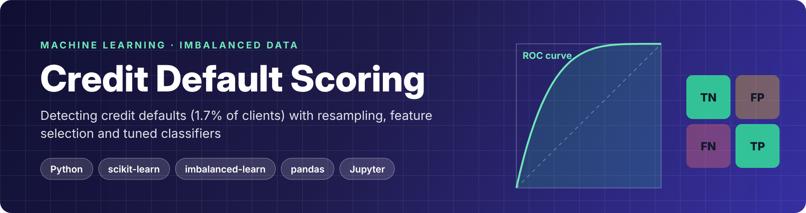
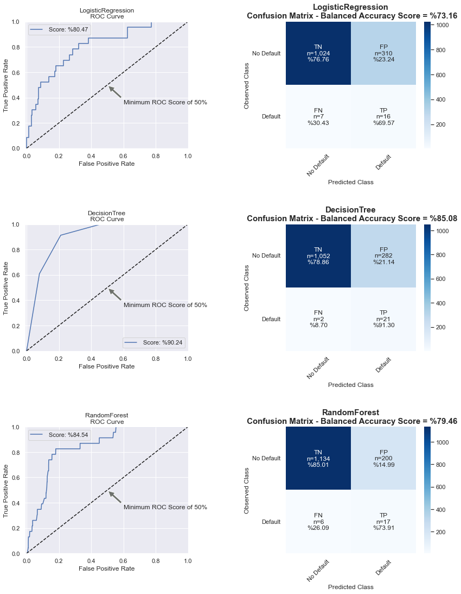

<p align="center">
  
</p>

🎓 *Academic project, completed during my university studies.*

This notebook predicts which bank clients are in **credit default**. Only 1.7% of clients are in default, so the main challenge is handling this strong imbalance.

## What I did

- Explored and prepared 4,521 client records from the UCI Bank Marketing dataset.
- Balanced the classes with **SMOTEENN**, applied inside cross-validation to avoid data leakage.
- Tuned and compared three models: Logistic Regression, Decision Tree and Random Forest.

## Results on the test set

| Model | ROC AUC | Defaults detected | Accuracy |
|---|:---:|:---:|:---:|
| Logistic Regression | 0.80 | 70% | 77% |
| Decision Tree | **0.90** | **91%** | 79% |
| Random Forest | 0.85 | 74% | **85%** |

The Decision Tree catches the most defaults, while the Random Forest raises the fewest false alarms.

<p align="center">
  
</p>

📄 The full notebook is here: [credit_scoring.pdf](reports/credit_scoring.pdf)

## Built with

Python · pandas · scikit-learn · imbalanced-learn · Jupyter

## How to run

```bash
pip install -r requirements.txt
jupyter notebook credit_scoring.ipynb
```

## Author

**Sadok Triki** · [LinkedIn](https://www.linkedin.com/in/trikisadok) · [GitHub](https://github.com/TrikiSadok)
